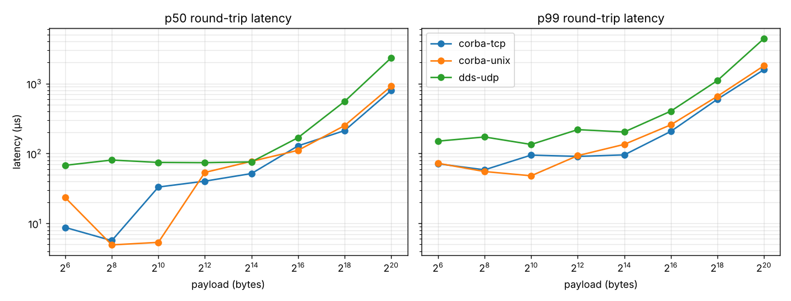

# dds-vs-corba-bench

Hands-on comparison of two OMG middleware standards that are still widely
used in embedded, defence and robotics systems:

| | CORBA (omniORB) | DDS (Eclipse Cyclone DDS) |
|---|---|---|
| Model | Remote objects, request/reply | Data-centric publish/subscribe |
| Coupling | Client needs the object reference (IOR) | Writers and readers only share a topic name and type |
| Discovery | IOR files / Naming Service | Automatic (SPDP/SEDP) |
| Wire protocol | GIOP over TCP or Unix sockets | RTPS over UDP (or shared memory) |
| QoS | Very limited | Reliability, durability, history, deadline, liveliness... |

The project has two parts:

1. **Hello world** (`status_pub` / `status_sub`): a keyed DDS topic with
   `RELIABLE` + `TRANSIENT_LOCAL` + `KEEP_LAST(1)` QoS, showing what makes DDS
   different from a plain message bus: late joiners receive the latest state
   of every instance, and readers are told when an instance is disposed.
2. **Latency benchmark**: the same payload (`seq` + `sequence<octet>`) sent
   round-trip through CORBA (`roundtrip()` call) and DDS (ping/pong topics),
   for payloads from 64 B to 1 MiB, reporting min/p50/p90/p99/p99.9/max.

> Personal learning project. Uses only synthetic data types and is not
> affiliated with any employer or programme.

## Layout

```
idl/dds/        DDS types (RadioStatus.idl, Bench.idl)
idl/corba/      CORBA interface (Bench.idl)
src/hello/      DDS hello world: publisher and subscriber
src/dds/        DDS ping-pong benchmark
src/corba/      CORBA echo server and client
common/stats.h  timing and percentile helpers shared by both benchmarks
config/         Cyclone DDS config for single-host runs (loopback, no multicast)
scripts/        run_local.sh (benchmark matrix), plot.py (charts)
results/        benchmark outputs
```

## Build

Tested on Ubuntu 24.04:

```bash
sudo apt install build-essential cmake pkg-config \
     cyclonedds-dev cyclonedds-tools \
     libomniorb4-dev omniidl
cmake -S . -B build
cmake --build build -j
```

`-DBUILD_DDS=OFF` or `-DBUILD_CORBA=OFF` builds only one side.

## Run the hello world

```bash
export CYCLONEDDS_URI=file://$PWD/config/cyclonedds-local.xml

./build/status_pub 20 3     # 3 radios, 20 updates every 500 ms
# a few seconds later, in another terminal:
./build/status_sub
```

The subscriber starts late but immediately prints the latest status of each
radio (durability), then follows the updates, then reports each radio as
disposed when the publisher exits. Things worth trying: change the
subscriber's durability to `VOLATILE` and it no longer gets the history;
make the writer `BEST_EFFORT` while the reader asks for `RELIABLE` and they
never match.

## Run the benchmark

```bash
scripts/run_local.sh                       # all sizes, 10 000 samples each
SIZES="64 4096" COUNT=2000 scripts/run_local.sh
python3 scripts/plot.py results/latest/summary.csv
```

Or by hand:

```bash
# CORBA, transport chosen with -ORBendPoint
./build/corba_server -i /tmp/echo.ior -ORBendPoint giop:unix:/tmp/echo.sock &
./build/corba_client -i /tmp/echo.ior -s 4096 -n 10000 -l corba-unix -q

# DDS
./build/dds_pingpong -m pong &
./build/dds_pingpong -m ping -s 4096 -n 10000 -l dds-udp
```

Each client prints one CSV line:
`transport,size_bytes,samples,min_us,p50_us,p90_us,p99_us,p999_us,max_us,mean_us`.
Use `-r file.txt` to also dump every raw round-trip time in nanoseconds.

## Sample results



Raw numbers: [`results/sample-cloud-vm/summary.csv`](results/sample-cloud-vm/summary.csv).

These come from a shared 2-vCPU cloud VM, so they are noisy and only show
the shape of the curves, not real-world figures. What they suggest so far:

- For a synchronous request/reply on a single host, **omniORB is faster than
  Cyclone DDS over UDP loopback** at every size. This is expected: the
  benchmark measures CORBA on its home turf (one call, one reply), while DDS
  pays for RTPS framing, the UDP stack and waitset wake-ups on both sides.
- Unix sockets help CORBA for small payloads, but the advantage is not
  consistent on this noisy machine.
- The interesting DDS cases are not covered yet: shared-memory / zero-copy
  transport, one-to-many distribution, and streaming without waiting for a
  reply (see roadmap).

## Roadmap

- [ ] Cyclone DDS with shared memory (iceoryx) and zero-copy loans
- [ ] Throughput test: continuous streaming (DDS `BEST_EFFORT`, CORBA `oneway`)
- [ ] One publisher, N subscribers: where pub/sub should clearly win
- [ ] Repeat on a Raspberry Pi (aarch64, cross-compiled) and across two hosts
- [ ] Pin processes to cores and isolate CPUs to reduce jitter
- [ ] Add Fast DDS as a second DDS implementation
